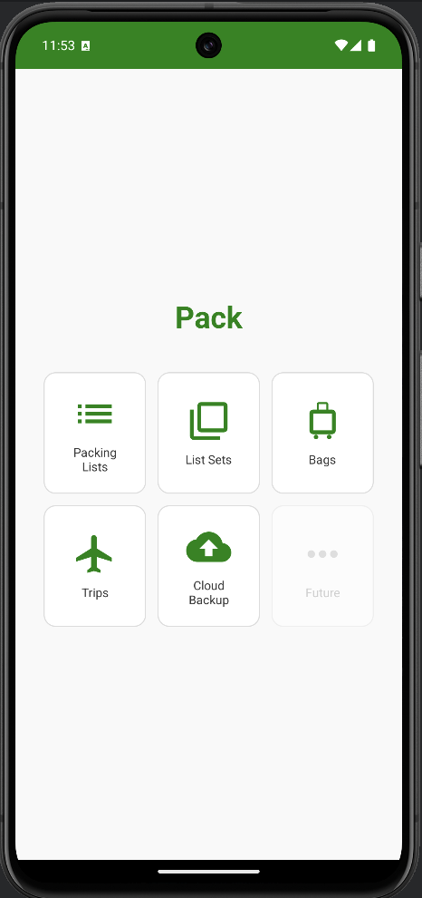

  

**Pack** is a simple, focused Android app for managing packing lists and organizing trips. It replaces the scattered notes and forgotten-item anxiety with a structured three-phase packing workflow: decide what to bring, pack it, and repack it for the journey home.

## Why Pack?

- **Reusable lists** -- Define your packing lists once and reuse them across every trip. No more recreating the same toiletries list from scratch.
- **Bag tracking** -- Know exactly which bag each item is in. Color-coded bag chips make it easy to see at a glance.
- **Three-phase workflow** -- Should Pack, Pack, Repack. A clear progression that ensures nothing gets left behind -- at home or at your destination.
- **Trip history** -- Copy past trips as a starting point. Your packing gets smarter over time.
- **Cloud backup** -- Back up your data to Google Drive so it survives device changes.

## Getting Started

1. **Create your packing lists** -- Start with lists like "Toiletries", "Clothes", "Electronics". Add items to each list.
2. **Define your bags** -- Create bags that match your real luggage: "Carry-on", "Checked Bag", "Daypack", etc. Pick a color for each.
3. **Bundle lists into sets** -- Group related lists into a List Set. For example, a "Weekend Trip" set might include "Clothes" and "Toiletries", while a "Beach Holiday" set adds "Beach Gear".
4. **Create a trip** -- When it's time to travel, create a trip from one of your list sets. Then work through the three packing tabs.

Head to [Features](features) for a detailed walkthrough, or jump to [Tips](tips) for power-user advice.
